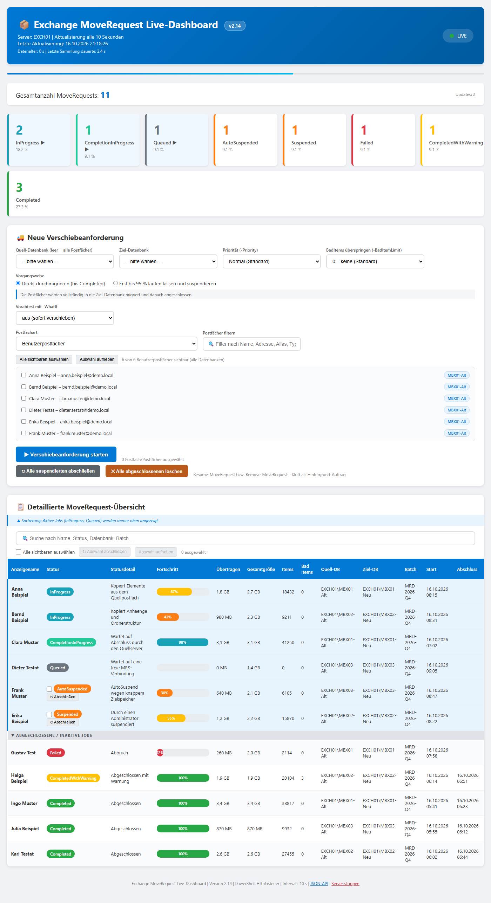

# Exchange MoveRequest Dashboard

[](https://gitlab.com/RoccoAmmon/Exchange-MoveRequest-Dashboard)
[](LICENSE)
[](CHANGELOG.md)
[](https://gitlab.com/RoccoAmmon/Exchange-MoveRequest-Dashboard/-/commits/main)
[](https://gitlab.com/RoccoAmmon/Exchange-MoveRequest-Dashboard/-/wikis/Architektur)
[](https://gitlab.com/RoccoAmmon/Exchange-MoveRequest-Dashboard/-/wikis/home)
<br>
[](https://gitlab.com/RoccoAmmon/Exchange-MoveRequest-Dashboard/-/wikis/Installation)
[](https://gitlab.com/RoccoAmmon/Exchange-MoveRequest-Dashboard/-/wikis/Installation)
[](https://gitlab.com/RoccoAmmon/Exchange-MoveRequest-Dashboard/-/wikis/Installation)
[](https://gitlab.com/RoccoAmmon/Exchange-MoveRequest-Dashboard/-/wikis/Fehlerbehebung)
[](https://gitlab.com/RoccoAmmon/Exchange-MoveRequest-Dashboard/-/wikis/Installation)



> **DE:** Die Web-Oberfläche des Dashboards – oben die Statuskacheln, mittig das Formular **„Neue Verschiebeanforderung"**, darunter die Live-Tabelle aller MoveRequests (aktive Jobs oben, suspendierte mit **„Abschließen"**-Button und Mehrfachauswahl). Die Aufnahme stammt aus einer Testfassung ohne Exchange-Anbindung und zeigt **Beispieldaten** – Servername, Postfächer und Zeiten sind frei erfunden. Die im Bild gezeigte Version **v2.14** entspricht dem Versions-Badge oben. In der Live-Umgebung aktualisiert sich die Seite automatisch (Standard-Intervall 10 s, ohne Seiten-Reload).
>
> **EN:** The dashboard's web UI – status tiles on top, the **"New move request"** form in the middle, and the live table of all move requests below (active jobs first, suspended ones with a **"Complete"** button and multi-selection). The screenshot was taken from a test build without an Exchange connection and shows **sample data** – server name, mailboxes and timestamps are fictional. The version shown in the image (**v2.14**) matches the version badge above. In a live environment the page refreshes automatically (default interval 10 s, no page reload).

**Live-Dashboard für Exchange Server MoveRequests** – ein einzelnes PowerShell-Skript startet einen lokalen
Mini-Webserver und zeigt in Echtzeit den Status aller Postfachverschiebungen an. Neu und abgeschlossene
Verschiebeanforderungen lassen sich direkt aus der Web-GUI starten, fortsetzen und aufräumen.

> 🖥️ Öffnet sich automatisch im Browser auf `http://localhost:8585/` · Autor: **Rocco Ammon**

---

## Features

| Bereich | Was es kann |
|---|---|
| **Live-Statistik** | Tabelle aller MoveRequests, aktualisiert per AJAX alle X Sekunden – **ohne** Seiten-Reload |
| **Aktive Jobs zuerst** | `InProgress`, `CompletionInProgress` und `Queued` stehen immer oben, abgeschlossene/fehlgeschlagene darunter |
| **Neue Verschiebung** | Postfächer einer Quell-Datenbank auswählen, Quelle/Ziel wählen, mit `New-MoveRequest` starten (eigener Hintergrund-Job, GUI bleibt bedienbar) |
| **Sonderpostfächer** | Eigenes Auswahlfeld **Postfachart**: *Benutzerpostfächer* / *Sonderpostfächer* / *Alle*. Zu den Sonderpostfächern zählen **Arbitration, AuditLog, AuxAuditLog, öffentliche Postfächer, Archiv**, SystemMailbox, Migration und Discovery – diese waren vorher komplett ausgefiltert und lassen sich nun getrennt anzeigen, auswählen und verschieben (Health-/Monitoring-Postfächer bleiben verborgen). Jeder Eintrag trägt seine Art als Markierung, postfächer ohne eigene SMTP-Adresse werden über Alias bzw. DN identifiziert |
| **Suspendierte fortsetzen** | Button **„Abschließen"** direkt hinter jeder suspendierten Tabellenzeile (einzelne Anforderung), **Mehrfachauswahl** mit Häkchen + „Auswahl abschließen" (ein Auftrag für die ganze Auswahl), zusätzlich pro Batch und global: `Resume-MoveRequest` als Hintergrund-Job, Fortschritt über `/api/move-status` |
| **Abgeschlossene löschen** | Pro Auftrag und global: `Remove-MoveRequest` – räumt nur die MoveRequests auf, die Postfächer bleiben unberührt |
| **Vorabtest** | `New-MoveRequest -WhatIf` vor dem eigentlichen Start (aus / erst prüfen dann verschieben / nur prüfen) |
| **Priorität & BadItemLimit** | Auswahl in der GUI, werden direkt an `New-MoveRequest` übergeben |
| **Stabil bei Last** | Snapshot-Cache, Stats-Cache, parallele Statistikabrufe, gedämmptes Log-Rotation – siehe [Stabilitätskern](#stabilitätskern-v20) |
| **Zweite Instanz** | Läuft auf dem Ziel-Port schon ein Dashboard, wird diese **beim Start automatisch beendet** (sauber über `/api/stop`, sonst `Stop-Process`) – Abschaltbar mit `-KeinAutoStopp`. Geprüft wird **zweimal**: einmal früh beim Start und noch einmal unmittelbar **vor** `$Listener.Start()`; nach Fehler 32 wird einmal nachgelegt |
| **Light-Modus** | `-Light` (Alias `-NurStatus`): nur Anzeigename, Status, Quell-/Ziel-DB und Batch – `Get-MoveRequestStatistics` bleibt komplett aus, die technischen Spalten sind ausgeblendet. Deutlich schneller bei vielen hundert Verschiebeanforderungen |
| **Filter** | Auf einen Move-Batch eingeschränkt starten (`-BatchName`), Quell-/Ziel-Datenbank frei wählbar |

## Voraussetzungen

- **Exchange Server 2019 On-Premises** (Management-Tools / Exchange Management Shell verfügbar)
- **Windows PowerShell 5.1** (skriptiert aus der Exchange Management Shell)
- Ausführung **als Administrator** – `System.Net.HttpListener` benötigt HTTP-Reservierungsrechte; startet das Skript ohne Admin-Rechte, hebt es sich selbst per UAC an (seit v2.14)
- Netzwerkzugriff auf den Exchange-Server (Localhost reicht, wenn das Skript auf dem Exchange läuft)

## Schnellstart

```powershell
# In einer *administrativen* Exchange Management Shell:
git clone https://gitlab.com/RoccoAmmon/Exchange-MoveRequest-Dashboard.git
cd Exchange-MoveRequest-Dashboard

.\Exchange-MoveRequest-Dashboard.ps1
# -> Browser öffnet http://localhost:8585/
```

Dashboard beenden: Schalter **„Server stoppen"** in der GUI oder `GET http://localhost:8585/api/stop`.

### Häufige Aufrufe

```powershell
# Anderer Port, kürzeres Aktualisierungsintervall
.\Exchange-MoveRequest-Dashboard.ps1 -Port 9090 -AktualisierungsIntervall 15

# Nur einen Move-Batch auswerten
.\Exchange-MoveRequest-Dashboard.ps1 -BatchName "MBX2026Q1"

# Sehr viele laufende Jobs: mehr parallele Detailabfragen, begrenzte Abfragen je Lauf
.\Exchange-MoveRequest-Dashboard.ps1 -Parallelitaet 8 -MaxDetailAbrufe 100

# Ohne Browserstart (z. B. für Remote-Sessions)
.\Exchange-MoveRequest-Dashboard.ps1 -KeinBrowser

# Light-Modus: nur der Status der Verschiebeanforderungen, ohne technische Werte
.\Exchange-MoveRequest-Dashboard.ps1 -Light
```

## Parameter

| Parameter | Standard | Beschreibung |
|---|---:|---|
| `-Port` | `8585` | Port des lokalen Webservers |
| `-AktualisierungsIntervall` | `10` | Sekunden zwischen zwei Polling-Läufen im Browser |
| `-CacheIntervall` | `5` | Sekunden, für die ein Snapshot ohne neue Exchange-Abfrage ausgeliefert wird |
| `-AbfrageTimeout` | `300` | Sekunden, nach denen der Browser einen `/api/data`-Request abbricht |
| `-LeerlaufIntervall` | `60` | Sekunden zwischen zwei Sammlungen, wenn keine aktiven Jobs mehr laufen |
| `-BatchName` | `""` | Filter auf einen Move-Batch |
| `-Parallelitaet` | `4` | Anzahl paralleler `Get-MoveRequestStatistics`-Abrufe (`1` = sequenziell) |
| `-MaxDetailAbrufe` | `0` | Max. Statistikabrufe pro Sammlung, `0` = unbegrenzt |
| `-KeinBrowser` | aus | Browser nicht automatisch öffnen |
| `-KeinAutoStopp` | aus | Andere Instanz auf demselben Port **nicht** automatisch beenden |
| `-Light` | aus | Light-Modus (Alias `-NurStatus`): nur Status, Name, Quell-/Ziel-DB und Batch – keine Statistikabrufe, technische Spalten ausgeblendet |

## API-Routen

| Route | Methode | Zweck |
|---|---|---|
| `/` | GET | Liefert die HTML-Dashboard-Seite (einmalig laden) |
| `/api/data` | GET | Aktuelle MoveRequest-Daten als JSON (gepollt) |
| `/api/databases` | GET | Alle Postfachdatenbanken (Quell-/Ziel-Auswahl) |
| `/api/benutzer` | GET | Postfächer (`?quelle=NAME`, `?typ=` mit `benutzer` / `sonder` / `alle` für die Postfachart; ohne Parameter alle Benutzerpostfächer aller Datenbanken) |
| `/api/move` | POST | Erstellt Verschiebeanforderungen (JSON: Quelle, Ziel, Benutzer, Suspend, Prioritaet, Vorabtest, BadItemLimit) |
| `/api/move-status` | GET | Status und Ergebnisse gestarteter Verschiebeaufträge |
| `/api/move-aktion` | POST | Suspendierte fortsetzen oder abgeschlossene löschen (JSON: Aktion, BatchName, Alle, Identity bzw. Identities) |
| `/api/stop` | GET | Stoppt den Webserver sauber |

## Stabilitätskern (v2.0)

Die folgenden Punkte verhindern den Totalausfall nach wenigen Minuten, der bei vielen Jobs zuvor auftrat:

1. **Sammlungs-Cache** – überlappende Requests bekommen sofort den letzten Snapshot statt die
   Exchange-Sammlung erneut anzufragen (19 s → 0,03 s).
2. **Stats-Cache** – `Get-MoveRequestStatistics` wird nur noch für *aktive* Jobs aufgerufen,
   abgeschlossene/fehlgeschlagene kommen aus dem Cache (235 → 188 Abrufe pro Sammlung).
3. **Kein Connection-Leak** – `Response.OutputStream.Close()` läuft in einem `finally`;
   ohne das leckte jeder fehlgeschlagene Request eine TCP-Verbindung (Port dicht nach ~10 min).
4. **Selbstkorrigierendes Polling** – `setTimeout`-Kette mit `AbortController` statt `setInterval`;
   der Browser stapelt keine Requests, wenn der Server langsam ist.
5. **Gedämmptes Logging** – dauerhaft offener `StreamWriter`, Rate-Limiting, Rotation ab 10 MB
   (5 Generationen).
6. **Stale-Snapshot** – schlägt eine Sammlung fehl, wird der letzte bekannte Stand mit
   Fehlerbanner ausgeliefert statt „Keine MoveRequests vorhanden".

## Logging

| | |
|---|---|
| Verzeichnis | `C:\ExchangeMigrationLog` |
| Datei | `LiveDashboard_<Zeitstempel>.log` |
| Rotation | ab 10 MB, 5 Generationen werden behalten |
| Rate-Limit | identische Meldungen werden innerhalb von 5 Minuten nur gezählt |

## Häufige Probleme

**`maxenvelopesizekb`-Fehler bei `Get-MoveRequestStatistics`**
In der Exchange Management Shell ausführen und das Skript neu starten:

```powershell
Set-PowerShellConfig -Identity WSMan:localhost -MaxEnvelopeSizeKb 16384
```

Das Skript ist auch ohne diesen Wert lauffähig, da abgeschlossene Jobs nicht mehr abgefragt werden.

**„Zugriff verweigert" / `HttpListenerException` beim Start**
Skript muss in einer *administrativen* Shell laufen (HTTP-Reservierung).

**Fehler 32 beim Start – „… da sie von einem anderen Prozess verwendet wird"**
Nicht der TCP-Port ist belegt, sondern die **URL-Präfix-Registrierung** `http://localhost:8585/`
von `http.sys`. Verursacht durch ein zweites Dashboard – auch die alte Version
`live_moverequest_statistik.ps1` reserviert denselben Port. Wichtig: **danach** ist der Port
sofort wieder frei, ein `netstat`-Check nach dem Fehler findet deshalb nichts mehr.

```powershell
# laufende Instanzen suchen (nur zum Fehlerzeitpunkt aussagekräftig)
Get-CimInstance Win32_Process |
    Where-Object { $_.CommandLine -match 'Moverequest-Dashboard|live_moverequest_statistik' } |
    Select-Object ProcessId, CommandLine

# oder einfach mit abweichendem Port starten
.\Exchange-MoveRequest-Dashboard.ps1 -Port 9090
```

Seit **v2.5** schreibt das Skript genau diese Daten (laufende Instanzen, Port-Listener, `netsh`-Reservierungen)
automatisch ins Log, sobald der Start scheitert.

Seit **v2.6** wird eine auf dem Ziel-Port laufende Instanz **vor** dem Start automatisch beendet – zuerst
per HTTP geprüft (das findet auch eine in einer offenen Konsole gestartete Instanz, deren Prozess die
Skriptdatei nicht in der Kommandozeile trägt), dann sauber über deren `/api/stop`, im Notfall per
`Stop-Process`. Mit `-KeinAutoStopp` ist das deaktiviert.

**Seit v2.8** wird die Prüfung **zweimal** ausgeführt: beim Start und noch einmal unmittelbar **vor**
`$Listener.Start()`. Dazwischen liegen Snap-In und erste Sammlung (rund 11 Sekunden) – genau in diesem
Fenster konnte sich eine zweite Instanz das URL-Praefix schnappen, worauf der Start mit Fehler 32
scheiterte. Schlägt der Start trotzdem mit einem Präfix-Konflikt fehl, wird **einmal nachgelegt**
(höchstens 3 Versuche, ohne `Ping-Pong` zwischen zwei Instanzen).

**Warnung „HTTP-Listener Fehler … Netzwerkname ist nicht mehr verfügbar" beim Stoppen**
Kein Fehler: Der Klick auf **„Server stoppen"** bricht die gerade laufende Browser-Anfrage ab,
während das Skript in deren Response-Stream schreibt – der Server fährt trotzdem sauber herunter
(`Server-Stop angefordert` → `HTTP-Server sauber heruntergefahren`). Seit **v2.9** erkennt das
Skript solche Client-Abbrüche und schreibt stattdessen eine harmlose `[STILL]`-Zeile mit
verständlichem Text – nur in die Datei, nicht auf die Konsole. Echte Listener-Fehler (etwa
„Zugriff verweigert") bleiben eine WARNUNG.

**Dashboard lädt, aber die Tabelle bleibt leer**
Prüfen, ob überhaupt MoveRequests existieren (`Get-MoveRequest`) und ob der Exchange-Management-Zugriff
aus der Shell funktioniert. Fehlermeldungen stehen im Log unter `C:\ExchangeMigrationLog`.

Weitere Details im [Wiki](https://gitlab.com/RoccoAmmon/Exchange-MoveRequest-Dashboard/-/wikis/home).

## Versionen

Alle Änderungen siehe [CHANGELOG.md](CHANGELOG.md).

| Version | Schwerpunkt |
|---|---|
| 2.14 | **Selbst-Elevation**: ohne Admin-Rechte startet das Skript sich automatisch mit UAC elevated neu (alle Parameter bleiben erhalten); bei Ablehnung Log-Warnung und Hinweisdialog |
| 2.13 | Fehlgeschlagene Verschiebungen nennen Ausführungskontext (Konto, Administrator-Status, PowerShell), Exception-Details und einen Handlungshinweis („Zugriff wurde verweigert") |
| 2.12 | System-/Arbitration-Postfächer über eigene `Get-Mailbox`-Schalter abrufen (vorher in der Sonderliste ausgeblendet) – dazu die Ansicht „Postfächer mit Archiv" |
| 2.11 | Versionsnummer in der Web-Oberfläche (Marke im Kopf, Seitentitel, Fußzeile) – aus dem `.NOTES`-Block gelesen |
| 2.10 | Sonderpostfächer (Arbitration, AuditLog, AuxAuditLog, öffentliche Postfächer, Archiv) separat anzeigen, auswählen und verschieben |
| 2.9 | Beim Stoppen über die Seite keine Fehlwarnung mehr – Browser-Abbruch gilt nicht als Listener-Fehler |
| 2.8 | Fehler 32 behoben (Prüfung direkt vor `$Listener.Start()` + ein Nachlegen), Light-Modus `-Light` |
| 2.7 | Mehrfachauswahl suspendierter Anforderungen – auswählen und mit einem Klick abschließen (`Identities`) |
| 2.6 | Zweite Instanz auf demselben Port wird beim Start automatisch beendet (Fehler 32 vorab), `-KeinAutoStopp` |
| 2.5 | Diagnose beim Startfehler: zweite Instanz, Port-Listener und URL-Reservierungen im Fehlerfall |
| 2.4 | Button „Abschließen" pro suspendierter Anforderung, Einzelziel über `Identity` |
| 2.3 | Schneller Erstablauf, parallele Statistikabrufe (Runspace-Pool), `-MaxDetailAbrufe` |
| 2.2 | WebGUI „Neue Verschiebeanforderung", Suspendierte fortsetzen, Abgeschlossene löschen, Vorabtest |
| 2.1 | Cache-Schlüssel korrigiert, Größenangaben in MB/GB, UTF-8 mit BOM |
| 2.0 | Stabilitätskern: Caches, Leck-Fix, selbstkorrigierendes Polling, Log-Rotation |
| 1.0 | Initiale Version |

## Mitwirken

Issues und Merge Requests sind willkommen – am besten mit

- Exchange-Version und PowerShell-Version
- Anzahl der gleichzeitigen MoveRequests
- Auszug aus dem Log unter `C:\ExchangeMigrationLog`

## Lizenz

[MIT](LICENSE) – © 2026 Rocco Ammon
